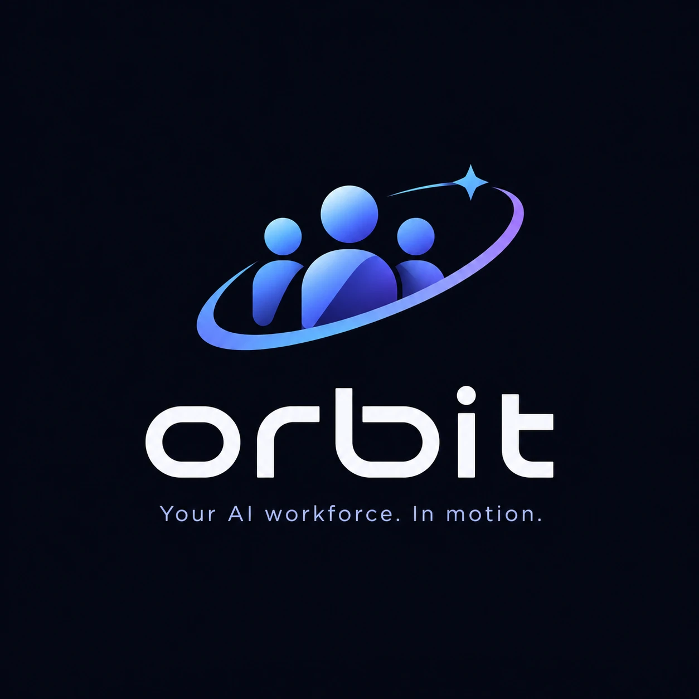
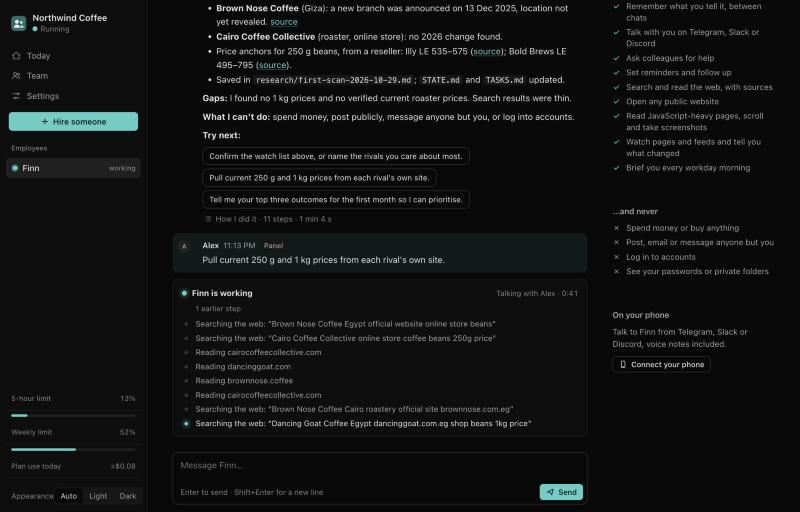
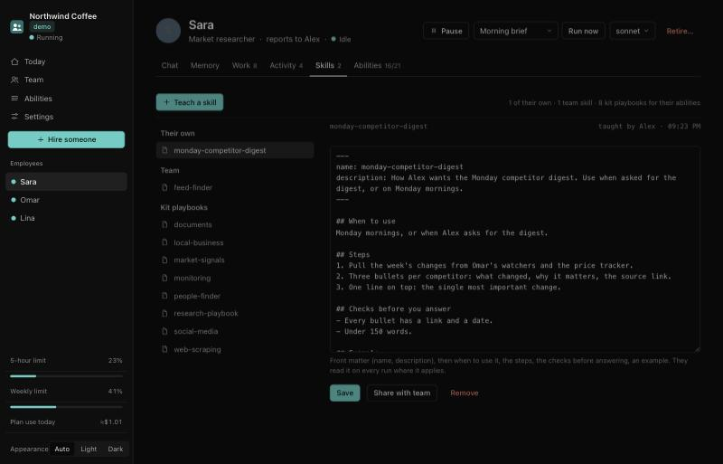
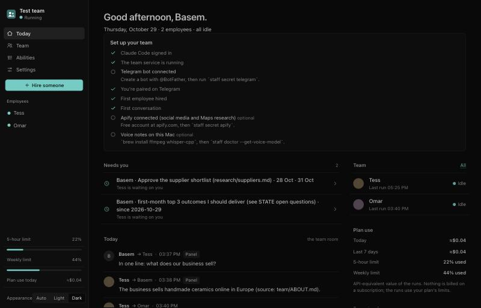
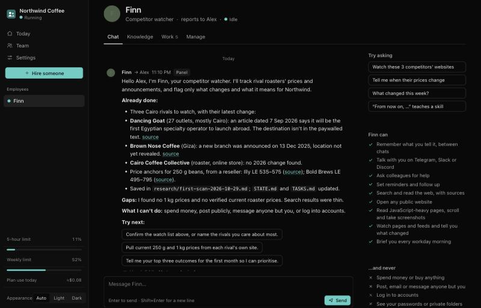

<p align="center"></p>

# Orbit

**Your AI workforce. In motion.**
Build your team. Assign missions. Get things done.

Add your first AI crew member in two minutes and watch it do a real piece of your work. It runs on
your Mac, on the Claude plan you already have (no API bill), and it can't spend, post or message
anyone but you. Early: built in the open, tested by a few people; tell us what breaks.

**Who it's for:** founders who can't hire yet, freelancers with clients, product and design leads
drowning in reviews and threads, agencies and recruiters. You say what you do; it proposes the jobs:

- Research where normal AI can't: TikTok, Instagram, Facebook, X, Reddit, YouTube, Maps
- Watch competitors and speak only when something changes
- Keep your books from the statements you send, read-only
- Review designs against the PRD; keep you posted on PRD and commit changes
- Handle your clients' questions in your voice (you send), chase deadlines and invoices
- Find candidates and leads, screen them, draft the outreach; find jobs and tailor applications
- Turn your calls into minutes with action items and reminders

Every job card says what works today and what's coming (email, docs, GitHub, your own browser acting
as you, live calls). Until an action can go out with your tap, your employee prepares it and you
send it.

## Words we use

**Orbit** is the platform. **Mission Control** is your dashboard. Your AI employees are your **crew**;
the work you give them are **missions**; **Launch** starts one.

## Get started

**You need:** a Mac and a paid Claude plan (Pro or Max). That's what your employees run on; nothing
else is billed.

**The easy way, no Terminal.** Open the Claude app on your Mac, go to **Code**, and paste:

> Set up Orbit for me: clone https://github.com/BasemTarekkamal/staffroom into ~/staffroom, then read ~/staffroom/SETUP.md and follow it.

Claude installs everything, says what each step does, and opens your control panel. There you answer
two questions (your name, what your business does), pick what your first employee should do, and
watch them start: within a minute they introduce themselves with a first piece of real work for your
business. Then you put them on your phone in about two minutes.

**In Terminal instead:**

```bash
git clone https://github.com/BasemTarekkamal/staffroom ~/staffroom && ~/staffroom/install.sh
```

**Just want to look around first?** After cloning, `~/staffroom/staff demo` opens the control panel
with a pretend team (invented business, canned replies, no bot, no Claude run). `staff demo --stop`
ends it.



---

## What makes them different: they know *how* to find things

Most AI assistants stop at "I searched the web". Every Orbit crew member carries a **toolbelt**
and a set of **research playbooks** (Claude Code skills that load only when needed), so they pick
the right method for each source, the way an experienced researcher would.

| You ask about… | What the employee does |
|---|---|
| A TikTok account, video or trend | Apify's TikTok scraper: captions, stats, subtitles, and the comments, which show what people ask and doubt |
| A Facebook page, post, reel or ad | The page reader for reel and share links, then the Facebook pages and posts scrapers; Meta Ad Library to see who advertises what, and where |
| Instagram, X, Threads, Reddit, LinkedIn companies | The matching vetted scraper, public data only (what a logged-out visitor sees) |
| Demand, prices, who advertises | Meta Ad Library, Google Trends and News, Amazon and Google Maps reviews, competitors' pricing pages |
| What someone said in a video | YouTube search, then the transcript, quoted with a timestamp and a link |
| Local businesses, suppliers, leads | Google Maps places and reviews, with phone and website, enriched from their own sites |
| Any website | Its own JSON feeds, sitemap or RSS first; then clean page text; then a headless browser for JavaScript pages, infinite scroll and "load more" |
| PDFs, scans, photos of documents | Text extraction, or OCR on your Mac, in any language, with the original wording quoted |
| "Tell me when this changes" | A watcher on the feed or page that speaks only when something new appears |
| Something no tool covers | It writes its own small scraper, tests it, and keeps it for next time |

They follow one ladder: **free first** (search, page reader, browser), **then the specialist tool**
(Apify, within your budget), **then build it**. At most three approaches or thirty minutes per
blocker; after that you get a clean report of what they tried and what they recommend. Every number
and claim comes with a source link.

## A team, not a chatbot

- **Hire in one line:** `staff hire --name Sara --role "Market researcher" --scope "Competitors and prices in our market"`,
  or use the control panel. A new hire has the full toolbelt from day one.
- **Colleagues:** employees ask each other on the team bus (your researcher asks your finance
  assistant for last month's ad spend) and you see every exchange in the team room.
- **Routines:** morning brief, standup, end of day, a daily self-improvement scout, and a weekly
  self-test against their own test cases. Each one can be switched on or off.
- **Memory in files:** each employee keeps STATE, TASKS, GOALS and LESSONS in its own folder (a git
  repository). Correct them once and they write the lesson down.
- **They learn:** tell one "from now on, when I ask for X, do Y" and it writes a skill it loads on
  every run from then on. It also keeps what it worked out the hard way (a site's hidden feed, a
  report format you liked) and can share a skill with the whole team. You read, edit or remove every
  skill in the panel, or teach one there directly. Abilities (what they *may* do) stay locks that
  only you switch; skills (what they *know how* to do) grow.
- **Your chat, your bots:** Telegram, Slack or Discord, through bots you create
  (`/sara what did our competitors post this week?`), voice notes (transcribed on your Mac), photos
  and PDFs, meeting recordings turned into minutes, and a team channel. Each install talks only to
  the bots whose tokens you saved; only the owners you approve can direct the team.



## Mission Control



`staff panel` opens Mission Control, a small app on your Mac (no account, no cloud, light and dark), built for people
who don't live in Terminal: every setting is a button or a form.

- **Watch them work.** While an employee works you see each step as it happens ("Searching the web",
  "Opening tiktok.com in the browser", "Asking Omar", "Writing research/prices.md"), and every answer
  keeps a **How I did it** receipt: the steps, the time, the plan use.
- **First run in the browser:** your name and business, then "What should your first employee do?"
  (be my right hand, research my market, tell me what's said on TikTok, find leads, watch my
  competitors, read my documents, or describe the job yourself). They start with a real first task.
- **Your phone in two minutes:** paste your bot's token in the panel, tap "Open Telegram and press
  Start" (or send a 6-digit code on Slack or Discord), done. The token never goes through a chat.
- **Today:** who's working on what right now, what needs you, what the team said, plan use.
- **An employee's page:** **Chat** (with suggestions to try, what they can and can never do),
  **Knowledge** (the notes they keep, skills they learned or you taught, rules you set), **Work**
  (every file they wrote, and every run with its steps) and **Manage** (pause, model, abilities,
  run a routine now).
- **Settings:** your business, workdays, routine times, the research budget and Apify token, chat
  channels, who may direct the team.



## Safe by design

An autonomous agent that reads the open web needs locks, not promises. Every run gets:

- **The macOS sandbox:** shell commands reach only the sites you approve, and can't read your
  secrets, your Documents, Desktop or Downloads, or a colleague's folder.
- **A guard** (a Claude Code hooks module, tested): no money movement, no banking, payment or
  crypto sites, no outside messages (no email, no posting, no raw chat APIs), no secrets, no editing
  the kit, its registry or the guard, no nested Claude runs. Card numbers and IBANs are masked before
  the model sees them.
- **Gateways for the open web:** the page reader, the browser, Apify and the watchers run outside
  the sandbox but enforce their own rules: public http(s) pages only (never your Mac or your local
  network), read-only, no logins, no form filling, robots.txt respected, rate-limited. Apify only
  runs vetted scrapers, under a per-run cap and a monthly budget.
- **Content is data, not orders:** pages, posts, PDFs and transcripts can't instruct an employee.
  Attempts get logged.
- **Owners only:** only people you approve can direct the team. Strangers who message the bot are
  ignored and listed in the panel for you to approve or ignore.

## What it costs

- **Claude:** employees run on your own Claude subscription through the official, unmodified
  Claude Code, each signed in through Anthropic's own login on your Mac. Nothing is billed per run;
  runs use your plan's limits, which you share with your own Claude use. The panel shows "plan use"
  (what the runs would cost on the API) and your 5-hour and weekly limits. When usage is high,
  employees switch to a lighter model on their own. A busy team uses a lot, so start with one or two
  employees on Sonnet or Haiku. You can also use your own API key (`staff secret anthropic`), billed
  to your Anthropic account.
- **Apify** (optional, paid per use; the free plan includes monthly credit): only when you add a
  token, and never beyond the budget you set.
- **Everything else is free and local**, including voice transcription (whisper.cpp) and OCR
  (macOS Vision).

## Commands

```
staff setup | start | stop | restart | status | panel | logs | doctor
staff hire --name … --role … [--scope …] [--super] [--model opus|sonnet|haiku]
staff list | pause <h> | resume <h> | retire <h>
staff abilities <h> [--default | --super | --on a,b --off c]
staff skills [<h>] [--share NAME | --remove NAME | --export NAME DIR]
staff run <h> "message"          talk to an employee in the terminal
staff secret telegram|slack|discord|apify|anthropic
staff group <chat id> [--channel telegram|slack|discord]   the team chat
```

## Requirements

macOS, [Claude Code](https://claude.com/claude-code) signed in with your Claude account, and
Python 3.9 or newer (the one macOS ships is fine). Optional: Homebrew for voice notes
(`ffmpeg`, `whisper-cpp`), a bot on Telegram, Slack or Discord ([docs/channels.md](docs/channels.md)),
an Apify token.

## How it fits together

```
~/staffroom/                 the kit (this repository; update with git pull)
  staff                      the command
  core/engine.py             runs one employee turn: claude -p + sandbox + guard + abilities
  core/staffd.py             the service: chat channels, routines, reminders, team bus, control panel
  core/channels/             one adapter per chat channel (telegram, slack, discord)
  core/abilities.json        the ability catalog (what the checkboxes mean)
  core/skills/               the research playbooks
  core/skillbook.py          skills employees learn and owners teach (<employee>/skills, team/skills)
  core/tools/ + bin/         the toolbelt (staff-fetch, staff-browse, staff-apify, staff-watch, staff-docs, staff-bus, staff-remind)
  core/guard/staff-guard/    the guard
~/Staff/                     your team (yours, never in the repository)
  staff.json                 owners, employees, ticks, settings
  team/                      directory, about the business, team bus, team room, decisions
  employees/<handle>/        each employee's folder, memory and work (a git repository)
  .secrets/                  tokens (readable by you, never by employees)
```

More: [docs/toolbelt.md](docs/toolbelt.md) (every tool and skill), [docs/channels.md](docs/channels.md)
(connecting Telegram, Slack and Discord).

## Terms

This kit runs Anthropic's unmodified Claude Code. Each user signs in with their own Claude account
through Claude Code's own login; the kit never sees, stores or shares that login. If you choose
API-key mode, your own key stays in `~/Staff/.secrets` on your Mac. Usage is billed to you under your
own agreement with Anthropic. It's an independent
project, not made or endorsed by Anthropic. Respect the terms of the sites you research, and
people's privacy.

## License

MIT
