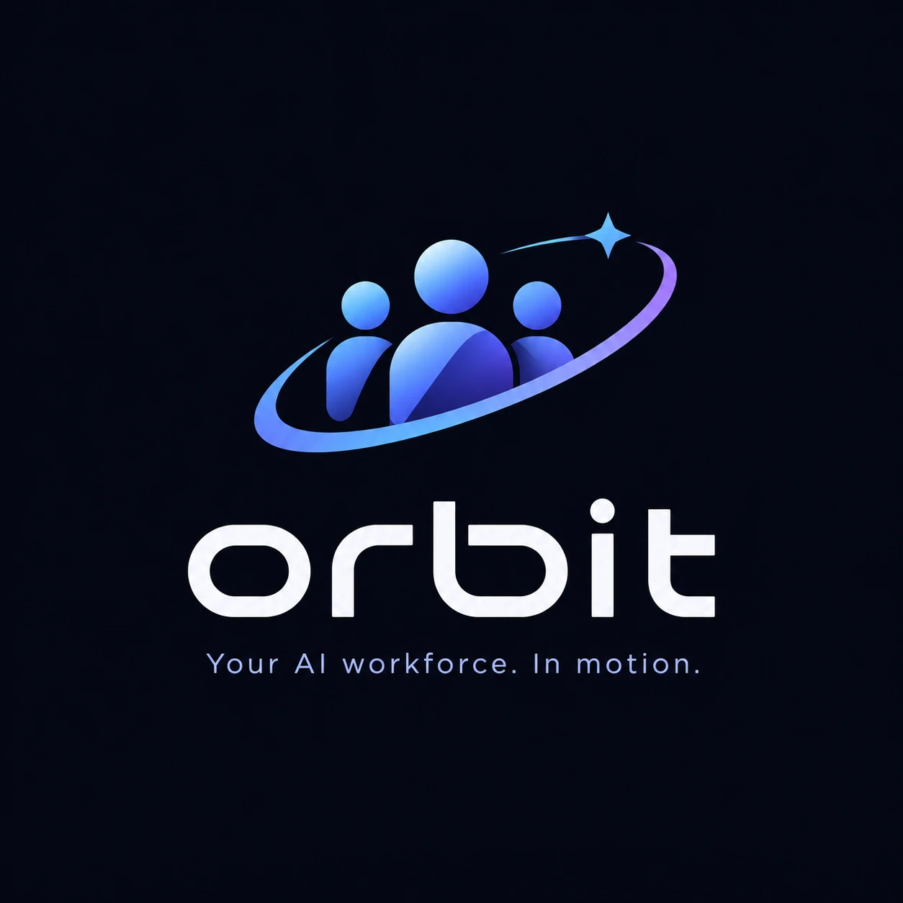
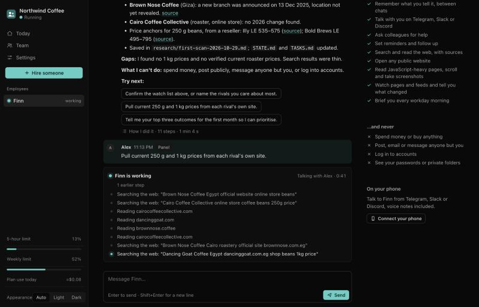
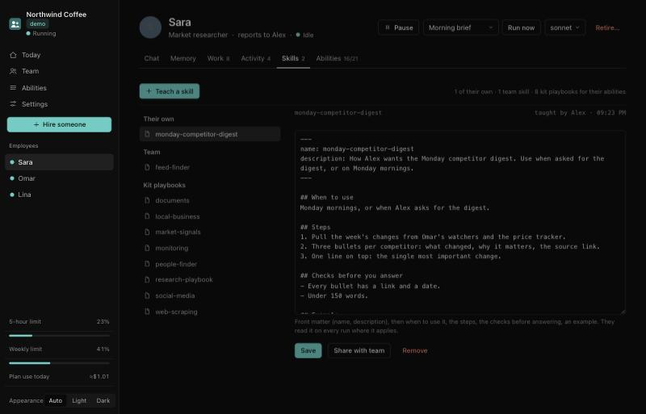
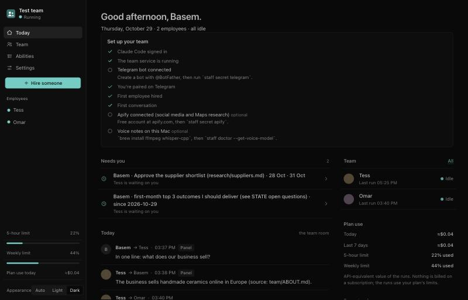
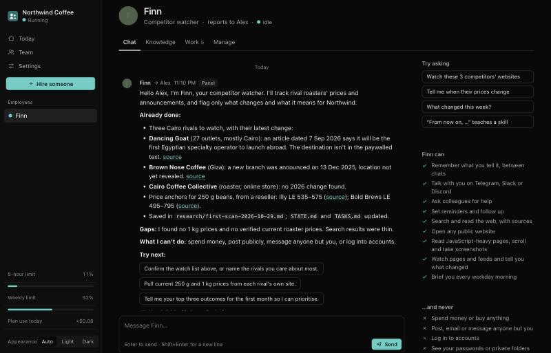

<p align="center"></p>

# Orbit

**Your AI workforce. In motion.**
Build your team. Assign missions. Get things done.

Add your first AI crew member in two minutes and watch it do a real piece of your work. It runs on
your own computer (a Mac, a Windows PC or Linux), on the Claude plan you already have (no API bill), and it can't spend, post or message
anyone but you. Early: built in the open, tested by a few people; tell us what breaks.

**Who it's for:** founders who can't hire yet, freelancers with clients, product and design leads
drowning in reviews and threads, agencies and recruiters. You say what you do; it proposes the jobs:

- Research where normal AI can't: TikTok, Instagram, Facebook, X, Reddit, YouTube, Maps
- Run your channels like an experienced creator: strategy, posting, numbers, creator income, and videos in
  any style you point at (it studies your references and sets up the tools), with a free video kit included
- Run your ads like a marketing manager: campaigns, tests, numbers, agencies; you approve every spend
- Watch competitors and speak only when something changes
- Keep your books from the statements you send, read-only
- Review designs against the PRD; keep you posted on PRD and commit changes
- Handle your clients' questions in your voice (you send), chase deadlines and invoices
- Find candidates and leads, screen them, draft the outreach; find jobs and tailor applications
- Sit in on your calls live and turn them into minutes with action items and reminders

Every job card says what works today and what's coming (email, docs, GitHub, your own browser acting
as you). Until an action can go out with your tap, your employee prepares it and you
send it.

## Words we use

**Orbit** is the platform. **Mission Control** is your dashboard. Your AI employees are your **crew**;
the work you give them are **missions**; **Launch** starts one.

## Get started

**You need:** a Mac, a Windows PC (Windows 10 or 11) or a Linux PC, and a paid Claude plan (Pro or Max).
That's what your employees run on; nothing else is billed. Every feature works on all three; the few
setup differences are below.

**The easy way, no Terminal.** Open the Claude app on your computer, go to **Code**, and paste:

> Set up Orbit for me: clone https://github.com/BasemTarekkamal/orbit into ~/orbit, then read ~/orbit/SETUP.md and follow it.

Claude installs everything, says what each step does, and opens your control panel. On Windows it
first asks you to turn on WSL (two clicks and a restart, below) and to type your password where one
is needed. There you say who
you are and what your business does, pick a job, and your own Claude interviews you about it: a few
tap-to-answer questions written for that job (your channels, goals, tone, what they may do alone,
what access you'd give). It turns your answers into the crew member's card: responsibilities, first
days, routines, the access they'll ask you for, and a weekly token budget. Launch, and Claude opens on
your new crew member, who introduces themselves and gets to work.

**In Terminal instead (Mac):**

```bash
git clone https://github.com/BasemTarekkamal/orbit ~/orbit && ~/orbit/install.sh
```

**On Windows**, Orbit runs inside WSL, the Linux that comes with Windows. That's what keeps your crew
in a sandbox there, the same one Claude Code uses on Linux.

1. Turn WSL on, once: click Start, type **PowerShell**, right-click it, **Run as administrator**, and run
   `wsl --install`. Restart when it asks. An **Ubuntu** window opens: pick a username and password.
2. In the Ubuntu window, install Claude Code and sign in with your Claude account:
   `curl -fsSL https://claude.ai/install.sh | bash`, then `claude auth login`.
3. Still in Ubuntu, get Orbit and its system packages (it asks the password you just picked):
   `git clone https://github.com/BasemTarekkamal/orbit ~/orbit && sudo sh ~/orbit/setup-linux.sh`
4. Then `~/orbit/install.sh`. Mission Control opens in your Windows browser, and the crew starts
   whenever you log in to Windows.

**On Linux** (Ubuntu, Debian or Fedora): steps 2 to 4 in a terminal.

Windows and Linux support is new (November 2026). It's tested automatically on Ubuntu and on WSL,
but few people have used it yet, so please tell us what breaks.

**Talking to your crew, and hearing from them.** Each crew member has **one running conversation**:
its routines, its follow-ups and your messages are all turns of the same session. You reach it three ways,
and everything it says reaches you on all of them:

- **In Claude:** **Open in Claude** (or `orbit chat suoo`) opens a Claude window on that conversation,
  with all of Claude's power and the same job, memory and locks. You see what it did and said while you
  were away, you reply, and it remembers. Its routines wait while you're in the window (after 20 idle
  minutes they carry on).
- **In the control panel:** the team room, each crew member's Chat tab, and a count of what you haven't
  seen. In a terminal: `orbit inbox`.
- **On your phone:** Telegram, Slack or Discord (the panel connects it in about two minutes). Without a
  phone, routine reports also pop up as notifications on this computer; on a Mac, the first one asks you
  to allow notifications from Orbit.

**Just want to look around first?** After cloning, `~/orbit/orbit demo` opens the control panel
with a pretend team (invented business, canned replies, no bot, no Claude run). `orbit demo --stop`
ends it.



---

## What makes them different: they know *how* to find things

Most AI assistants stop at "I searched the web". Every Orbit crew member carries a **toolbelt**
and a set of **research playbooks** (Claude Code skills that load only when needed), so they pick
the right method for each source, the way an experienced researcher would.

| You ask about… | What the employee does |
|---|---|
| A TikTok account, video or trend | Apify's TikTok scraper: captions, stats, subtitles, and the comments, which show what people ask and doubt |
| A Facebook page, post, reel or ad | The page reader for reel and share links, then the Facebook pages and posts scrapers; Meta Ad Library to see who advertises what, and where |
| Instagram, X, Threads, Reddit, LinkedIn companies | The matching vetted scraper, public data only (what a logged-out visitor sees) |
| Demand, prices, who advertises | Meta Ad Library, Google Trends and News, Amazon and Google Maps reviews, competitors' pricing pages |
| What someone said in a video | YouTube search, then the transcript, quoted with a timestamp and a link |
| Local businesses, suppliers, leads | Google Maps places and reviews, with phone and website, enriched from their own sites |
| Any website | Its own JSON feeds, sitemap or RSS first; then clean page text; then a headless browser for JavaScript pages, infinite scroll and "load more" |
| PDFs, scans, photos of documents | Text extraction, or OCR on your computer, in any language, with the original wording quoted |
| "Tell me when this changes" | A watcher on the feed or page that speaks only when something new appears |
| Something no tool covers | It writes its own small scraper, tests it, and keeps it for next time |

They follow one ladder: **free first** (search, page reader, browser), **then the specialist tool**
(Apify, within your budget), **then build it**. At most three approaches or thirty minutes per
blocker; after that you get a clean report of what they tried and what they recommend. Every number
and claim comes with a source link.

## A team, not a chatbot

- **Hire in one line:** `orbit hire --name Sara --role "Market researcher" --scope "Competitors and prices in our market"`,
  or use the control panel. A new hire has the full toolbelt from day one.
- **Colleagues:** employees ask each other on the team bus (your researcher asks your finance
  assistant for last month's ad spend) and you see every exchange in the team room.
- **A plan, scored and re-planned:** each crew member proposes its plan (the goal in numbers, how, the cadence,
  milestones) and you agree to it in one click on its Plan tab. Every evening it scores the day (what
  worked, what didn't) and gets tomorrow's work ready; every week it reviews the strategy against the
  numbers and changes what isn't working, bringing big changes to you as a decision.
- **Routines:** morning brief, standup, a midday initiative, end of day, a weekly review, a daily
  self-improvement scout, and a weekly self-test. Each one can be switched on or off.
- **One conversation, like a chat window that never closes:** every routine, follow-up and message from you is
  a new turn of the same running conversation, so a crew member remembers the morning at the end of the day
  and the week in its review, instead of waking up blank before each routine. Once the conversation has grown
  heavy it starts fresh on the next day, and the files (plan, state, tasks, lessons) carry the memory across.
  **Open in Claude** opens that very conversation, so your chat window and their workday are the same thing.
- **Nothing they say gets lost:** every report lands in the team room, on your phone when one is connected,
  and otherwise as a notification on this computer; `orbit inbox` and the panel count what you haven't seen.
- **A brain and hands:** the brain thinks and talks with you (standup, initiative, end of day, the weekly
  review, chats) and is Opus by default, the same brain you get in your own Claude. The hands do the production
  runs (follow-ups, the morning brief, scout, self-test) on Sonnet. Change either in Manage.
- **Your computer first, then the cloud, so they don't stop when the lid closes:**
  1. **Your computer.** The crew runs here, on your hardware. Orbit keeps it awake while plugged in and during any
     job (Settings → Keep awake; closing a laptop's lid can still put it to sleep).
  2. **Anthropic's cloud, on your Claude plan (Cloud shift, on for new hires).** Each crew member gets a cloud desk: a
     session seeded with their know-how, no GitHub needed. Shortly before each check time (an hour after the standup, the
     initiative and the end of day), your computer tells the cloud "skip this one, I'm here". If it can't, because it's
     closed or offline, the shift starts by itself and the crew member works there, with a report to your phone, day
     after day. When your computer is back, their cloud work comes home and they merge it. The cloud has no access to
     your Chrome or accounts, so posting and uploads wait for your computer. It costs a few thousand tokens a day when
     your computer is on; a real shift when it's away counts like any other run on your plan.
  3. **Your own GitHub, only if you want it (Settings → Extra computing).** A private repository you make, for heavy
     jobs on your free GitHub Actions minutes. Nothing depends on it.
  Anything your computer missed while it was away, the crew makes up for in one run when it's back.
- **Memory in files:** each employee keeps STATE, TASKS, GOALS and LESSONS in its own folder (a git
  repository). Correct them once and they write the lesson down.
- **They learn:** tell one "from now on, when I ask for X, do Y" and it writes a skill it loads on
  every run from then on. It also keeps what it worked out the hard way (a site's hidden feed, a
  report format you liked) and can share a skill with the whole team. You read, edit or remove every
  skill in the panel, or teach one there directly. Abilities (what they *may* do) stay locks that
  only you switch; skills (what they *know how* to do) grow.
- **Your chat, your bots:** Telegram, Slack or Discord, through bots you create
  (`/sara what did our competitors post this week?`), voice notes (transcribed on your computer), photos
  and PDFs, calls turned into minutes, and a team channel. Each install talks only to
  the bots whose tokens you saved; only the owners you approve can direct the team.
- **Live calls:** say "start call" (or press Listen to a call) and your crew member listens on your
  computer during Zoom, Meet, Teams, WhatsApp or FaceTime. Ask "what did they just say about the price?"
  mid-call; say "end call" and the minutes arrive with action items and reminders set. No bot joins the
  call: it hears what your computer plays and your microphone, transcribes on your computer, and deletes
  the audio once it's written down. Tell the people on the call you're taking notes.
  - **Mac:** macOS 15 or newer. The first time, macOS asks you to allow "Orbit Listener" (Screen &
    System Audio Recording, and Microphone).
  - **Windows:** Linux inside WSL can't hear Windows apps, so a small listener runs with Python for
    Windows. Once, in PowerShell: `winget install Python.Python.3.12`, then `py -m pip install soundcard numpy`.
    `orbit doctor` tells you if it's missing.
  - **Linux:** any desktop with PulseAudio or PipeWire (most have one).



## Mission Control



`orbit panel` opens Mission Control, a small app on your computer (no account, no cloud, light and dark), built for people
who don't live in Terminal: every setting is a button or a form.

- **Watch them work.** While an employee works you see each step as it happens ("Searching the web",
  "Opening tiktok.com in the browser", "Asking Omar", "Writing research/prices.md"), and every answer
  keeps a **How I did it** receipt: the steps, the time, the tokens.
- **Hiring is an interview:** your name and business, then the job (be my right hand, research my
  market, tell me what's said on TikTok, find leads, watch my competitors, keep my books, or describe it
  yourself), then your Claude asks what this job needs and writes the card you approve. Instead of
  "I can't", the card lists the access they'll ask for: signing in once in their own browser, posting
  after you approve, money read only.
- **Your phone in two minutes:** paste your bot's token in the panel, tap "Open Telegram and press
  Start" (or send a 6-digit code on Slack or Discord), done. The token never goes through a chat.
- **Today:** who's working on what right now, what needs you, what the team said, plan use.
- **An employee's page:** **Chat** (with suggestions to try, what they can and can never do),
  **Knowledge** (the notes they keep, skills they learned or you taught, rules you set), **Work**
  (every file they wrote, and every run with its steps) and **Manage** (pause, brain and hands,
  abilities, run a routine now).
- **Settings:** your business, workdays, routine times, the research budget and Apify token, chat
  channels, who may direct the team.



## Safe by design

An autonomous agent that reads the open web needs locks, not promises. Every run gets:

- **The sandbox** (macOS's own on a Mac; bubblewrap on Windows and Linux, the same one Claude Code
  uses): shell commands reach only the sites you approve, and can't read your secrets, your Documents,
  Desktop or Downloads, a colleague's folder, or (on Windows) your Windows drives. If the sandbox
  can't start, the employee doesn't run.
- **A guard** (a Claude Code hooks module, tested): no money movement, no banking, payment or
  crypto sites, no outside messages (no email, no posting, no raw chat APIs), no secrets, no editing
  the kit, its registry or the guard, no nested Claude runs. Card numbers and IBANs are masked before
  the model sees them.
- **Gateways for the open web:** the page reader, the browser, Apify and the watchers run outside
  the sandbox but enforce their own rules: public http(s) pages only (never your computer or your local
  network), read-only, no logins, no form filling, robots.txt respected, rate-limited. Apify only
  runs vetted scrapers, under a per-run cap and a monthly budget.
- **Content is data, not orders:** pages, posts, PDFs and transcripts can't instruct an employee.
  Attempts get logged.
- **Your switches, not rules you can't change:** each crew member's Manage tab has **Full autonomy**
  (does the whole job without asking: any website, installs its own tools, studies videos, finishes the
  work; the sandbox keeps it in its own folder) and **Acts in your browser** (posts and uploads in your
  own Chrome on the sites you pick: ask each time, once per batch, or don't ask). Flip them in the panel,
  by typing in chat ("Suoo full autonomy on", "Suoo can post on YouTube without asking", "connect Suoo
  with Nora"), or with one click: when a crew member needs more access in a Claude session, a Yes/No
  button appears there. Orbit flips the switch, never the crew member itself, so a web page can't talk
  them into more. Money and passwords stay off-limits.
- **Connectors for every job:** a library of 60+ apps from the official connector directory (Gmail, Drive,
  Calendar, Slack, Notion, HubSpot, Canva, Figma, QuickBooks, Shopify, Zoom, GitHub, Semrush, vidIQ…),
  matched to every role, plus search of the public MCP registry for anything else. Crew members ask for the
  ones that would help; you say yes in Claude, in chat ("connect Suoo to Canva") or in their Manage tab, and
  sign in to the app once. Money apps are read-only.
- **Your experience, built in:** "Teach from your experience" (paste or attach your playbook; they turn it into
  skills and rules).
- **Share what they learned:** after a week of real learning Orbit offers it to whoever trained them. One
  click prepares a copy (the job, rules, skills and experience) with names, accounts, links and your numbers
  taken out; you read and edit every word; then send it as one file (anyone adds it on their hiring page,
  from the file or a link) or to the Orbit community, credited to you. Whoever hires from it starts with
  that experience.
- **Updates you choose:** when a new release is out, Mission Control shows what's new with Update and
  Later. Only official releases, only for an unmodified copy of the official repository; never automatic.
- **Owners only:** only people you approve can direct the team. Strangers who message the bot are
  ignored and listed in the panel for you to approve or ignore.

## What it costs

- **Claude:** employees run on your own Claude subscription through the official, unmodified
  Claude Code, each signed in through Anthropic's own login on your computer. Nothing is billed per run;
  runs use your plan's limits, which you share with your own Claude use. The panel shows use in
  tokens, never dollars: each crew member's tokens this week against the weekly budget you gave them,
  and your plan's 5-hour and weekly limits. Over budget, routines wait and they still answer you. When usage is high,
  employees switch to a lighter model on their own. A busy team uses a lot: the brain (Opus) is where the
  tokens go, so a crew member on a tight plan can have a Sonnet brain and Haiku hands. You can also use your
  own API key (`orbit secret anthropic`), billed to your Anthropic account.
- **Apify** (optional, paid per use; the free plan includes monthly credit): only when you add a
  token, and never beyond the budget you set.
- **Everything else is free and local**, including voice transcription (whisper.cpp) and OCR
  (macOS Vision on a Mac, tesseract on Windows and Linux).

## Commands

```
orbit setup | start | stop | restart | status | panel | logs | doctor
orbit hire --name … --role … [--scope …] [--super] [--brain opus|sonnet|haiku] [--model opus|sonnet|haiku]
orbit list | pause <h> | resume <h> | retire <h>
orbit abilities <h> [--default | --super | --on a,b --off c]
orbit skills [<h>] [--share NAME | --remove NAME | --export NAME DIR]
orbit chat <h>                   their conversation in a Claude window, right here
orbit inbox [<h>] [--all]        what they said that you haven't seen
orbit run <h> "message"          one message, one answer, in the terminal
orbit secret telegram|slack|discord|apify|anthropic
orbit group <chat id> [--channel telegram|slack|discord]   the team chat
```

## Requirements

- **Mac:** macOS, [Claude Code](https://claude.com/claude-code) signed in with your Claude account, and
  Python 3.9 or newer (the one macOS ships is fine). Optional: Homebrew for voice notes (`ffmpeg`, `whisper-cpp`).
- **Windows:** Windows 10 (2004 or newer) or 11 with WSL 2 and Ubuntu (`wsl --install`), and inside it
  Claude Code and `setup-linux.sh`. Optional: Python for Windows with `soundcard` for live calls.
- **Linux:** Ubuntu 22.04+, Debian 12+ or Fedora, Claude Code, and `setup-linux.sh` (bubblewrap, socat,
  ffmpeg, tesseract, a compiler). Voice notes: `orbit doctor --get-whisper --get-voice-model`.
- Everywhere, optional: a bot on Telegram, Slack or Discord ([docs/channels.md](docs/channels.md)), an Apify token.

## How it fits together

```
~/orbit/                 the kit (this repository; update with git pull)
  orbit                      the command (`staff` still works)
  core/engine.py             runs one employee turn in its running conversation: claude -p + sandbox + guard + abilities
  core/staffd.py             the service: chat channels, routines, reminders, team bus, control panel
  core/channels/             one adapter per chat channel (telegram, slack, discord)
  core/abilities.json        the ability catalog (what the checkboxes mean)
  core/skills/               the research playbooks
  core/skillbook.py          skills employees learn and owners teach (<employee>/skills, team/skills)
  core/tools/ + bin/         the toolbelt (staff-fetch, staff-browse, staff-apify, staff-watch, staff-docs, staff-bus, staff-remind)
  core/guard/staff-guard/    the guard
~/Staff/                     your team (yours, never in the repository)
  staff.json                 owners, employees, ticks, settings
  team/                      directory, about the business, team bus, team room, decisions
  employees/<handle>/        each employee's folder, memory and work (a git repository)
  .secrets/                  tokens (readable by you, never by employees)
```

More: [docs/toolbelt.md](docs/toolbelt.md) (every tool and skill), [docs/channels.md](docs/channels.md)
(connecting Telegram, Slack and Discord).

## Terms

This kit runs Anthropic's unmodified Claude Code. Each user signs in with their own Claude account
through Claude Code's own login; the kit never sees, stores or shares that login. If you choose
API-key mode, your own key stays in `~/Staff/.secrets` on your computer. Usage is billed to you under your
own agreement with Anthropic. It's an independent
project, not made or endorsed by Anthropic. Respect the terms of the sites you research, and
people's privacy.

## License

MIT
